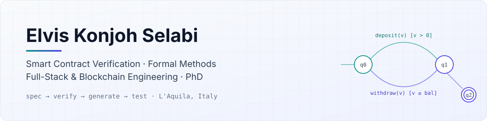
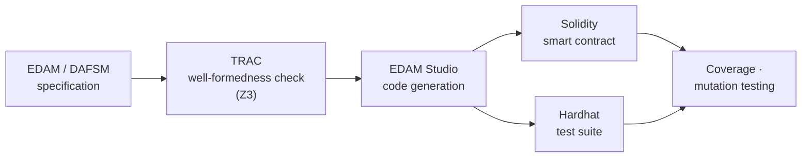

<picture>
  <source media="(prefers-color-scheme: dark)" srcset="./assets/header-dark.svg">
  <source media="(prefers-color-scheme: light)" srcset="./assets/header-light.svg">
  
</picture>

  
  
  
  
  

## About

I build smart contracts that are **correct by construction**. My work turns formal behavioural models into verified, generated Solidity code and executable test suites, so the gap between a protocol's specification and its deployed code disappears.

I hold a **Ph.D. in Computer Science** (Blockchain & Distributed Ledger Technologies) from the [Gran Sasso Science Institute](https://www.gssi.it) and the [University of Camerino](https://www.unicam.it). Before research, I spent a decade shipping production software: CRM platforms for 20,000+ users, ERP systems, mobile apps, and 15+ decentralized applications across DeFi, mobility and NFTs.

- 🔬 **Research** — formal methods, behavioural types, data-aware state machines, smart contract verification
- 🛠️ **Engineering** — full-stack web and mobile, cloud backends, DApps, AI/LLM integration
- 🌍 **Impact** — 100+ developers trained on blockchain; consulting for startups across Africa, Europe and Asia

## Currently

| Role | Organisation | Since |
| --- | --- | --- |
| Software Engineer & Researcher | **Gran Sasso Tech**, L'Aquila | Jan 2026 |
| Project Manager, [E-CoRe](https://e-core.nws.cs.unibo.it/) (MSCA network) | **Università di Bologna** | Feb 2026 |
| Decentralized Ledger Technology Specialist | Freelance · Remote | Mar 2020 |

## Research

### PhD thesis — *Analysis and Verification of Smart Contracts with Behavioural Types*
GSSI & UNICAM · defended June 2026 · supervisors: Dr. Maurizio Murgia, Prof. Emilio Tuosto · <a href="https://hdl.handle.net/11581/502957">handle 11581/502957</a>

Deployed smart contracts cannot be patched, and most costly exploits come from hand-written code. The thesis introduces **EDAM** (Enhanced Data-Aware Machines), a behavioural model that extends data-aware finite state machines with dynamic role-based access control, unbounded participants, and inter-contract calls with explicit success and failure handling. From an EDAM specification, the toolchain generates **Solidity contracts** and **executable Hardhat test suites**, evaluated on ERC20, AMM and other benchmarks through coverage analysis, mutation testing and cross-validation against existing implementations.

### Selected publications

- **Automatic Code and Test Generation of Smart Contracts from Coordination Models** 
  E. Konjoh Selabi, M. Murgia, A. Ravara, E. Tuosto · *ECOOP 2026*, LIPIcs vol. 372, 15:1–15:30 
  [DOI](https://doi.org/10.4230/LIPIcs.ECOOP.2026.15) · [arXiv](https://arxiv.org/abs/2604.20507) · [Artifact (DARTS)](https://doi.org/10.4230/DARTS.12.1.22) · [Zenodo](https://doi.org/10.5281/zenodo.18475933)

- **TRAC: A Tool for Data-Aware Coordination (with an Application to Smart Contracts)** 🏆 *Best Artefact Award* 
  J. Afonso, E. Konjoh Selabi, M. Murgia, A. Ravara, E. Tuosto · *COORDINATION 2024*, LNCS 14676, pp. 239–257 
  [DOI](https://doi.org/10.1007/978-3-031-62697-5_13) · [arXiv](https://arxiv.org/abs/2404.19523) · [Code](https://github.com/loctet/TRAC)

- **Enabling Citizen Sustainable Behaviors in Urban Mobility through Blockchain and Tokenization** 
  S. Meneguzzo, E. G. Konjoh Selabi, A. Favenza, V. Gatteschi, C. Schifanella · *Blockchain Technology in the Automotive Industry*, CRC Press 2024, ch. 15 
  [DOI](https://doi.org/10.1201/9781003450306-17)

## Featured projects

<table>
  <tr>
    <td width="50%" valign="top">
      <h3><a href="https://github.com/loctet/Edam-Studio">EDAM Studio</a></h3>
      
Toolchain that turns EDAM specifications into Solidity code and automated Hardhat tests. Visual graph editor, text editor, CLI and API workflows.

      
      
      
    </td>
    <td width="50%" valign="top">
      <h3><a href="https://github.com/loctet/TRAC">TRAC</a></h3>
      
Checks the well-formedness of data-aware finite state machines (DAFSMs) with an SMT solver, so protocol errors surface before any code exists. Best Artefact Award, COORDINATION 2024.

      
      
      
    </td>
  </tr>
  <tr>
    <td width="50%" valign="top">
      <h3><a href="https://github.com/loctet/GraphGen">GraphGen</a></h3>
      
FSM visualizer that renders finite state machines from JSON descriptions. Used by TRAC to draw protocol models.

      
    </td>
    <td width="50%" valign="top">
      <h3>ElectionCheck</h3>
      
Civic-tech mobile app for electoral transparency: secure chat, geolocated reporting, a blockchain audit trail for immutable evidence, and LLM-assisted fraud analysis.

      
      
      
    </td>
  </tr>
</table>

## Tech stack

**Languages** 
         

**Formal methods & verification** 
   

**Blockchain** 
     

**Web, mobile & cloud** 
       

**AI** 
  

## Recognition & service

- 🏆 **Best Artefact Award** + EAPLS *Available* and *Reusable* badges — COORDINATION 2024
- 🥈 **Second Prize**, IOTA Foundation Hackathon — Move smart contract DApp (2020)
- 🎤 **Invited speaker**, Ethereum Zurich 2025 · talk at **DTU** Copenhagen (2024)
- 🧑‍⚖️ **Artifact Evaluation Committee**, FM 2026 (Tokyo) · **Program Committee**, COMPSAC Mentorium 2025 (Toronto)
- 🎓 Ph.D. scholarship, GSSI (2022–2026) · Master scholarship & best student award, Zhejiang Provincial Government (2016–2017)

<b>Experience & education</b>

 

**Experience**

| Period | Role | Where |
| --- | --- | --- |
| 2026 – now | Software Engineer & Researcher | Gran Sasso Tech, L'Aquila |
| 2026 – now | Project Manager, E-CoRe (MSCA) | Università di Bologna |
| 2025 | Visiting Researcher (4 months) | Technical University of Denmark (DTU), Copenhagen |
| 2023 | Research Collaborator | NOVA University Lisbon |
| 2020 – now | DLT Specialist & trainer | Freelance |
| 2019 – 2023 | Full-Stack Web Developer, Scrum Master & Team Lead | Marco Vasco, Shanghai |
| 2013 – 2015 | Junior Software Engineer | AfreelTech & Infrastel, Yaoundé |

**Education**

| Period | Degree | Institution |
| --- | --- | --- |
| 2022 – 2026 | Ph.D. in Computer Science (BDLT) | GSSI & University of Camerino, Italy |
| 2015 – 2017 | M.Sc. in Software Engineering | Zhejiang Normal University, China |
| 2008 – 2013 | B.Sc. in Computer Science | University of Yaoundé I, Cameroon |

**Languages:** French (native) · English (C1) · Chinese (A1)

---

  <b>Open to research collaborations, postdoc positions, and blockchain / formal-methods engineering projects.</b> 
  Reach me on <a href="https://www.linkedin.com/in/elviskonjoh/">LinkedIn</a> or via <a href="https://linktr.ee/elviskonjoh">linktr.ee/elviskonjoh</a>.

